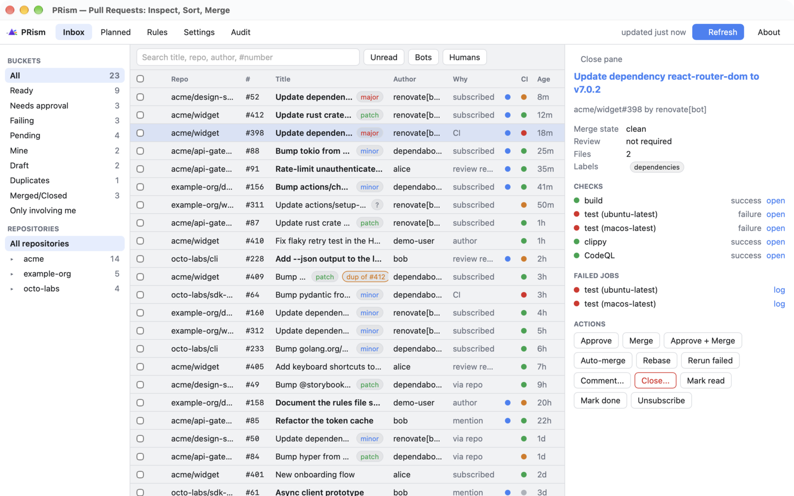
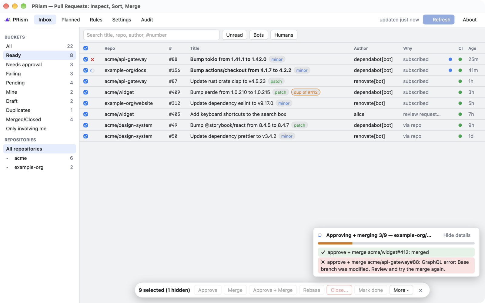
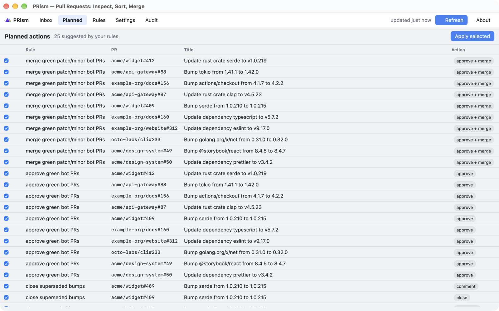

# PRism

**Pull Requests — Inspect, Sort, Merge.**

A desktop inbox for GitHub pull requests: review, approve and merge dependency bumps and other pull requests in bulk, and let simple rules do the routine work.

PRism is written in Rust on top of [Tauri v2](https://v2.tauri.app/) with a [Leptos](https://leptos.dev/) UI. It talks to GitHub with your own token; there is no server and no telemetry.

## Screenshots



<details>
<summary>More screenshots (demo data)</summary>





</details>

## Features

- One inbox of the open pull requests you are involved in: those that notify you, those that wait for your review and those you wrote.
- Optionally, all open pull requests of repositories you choose are added too (see [Repository scope](#repository-scope)).
- Pull requests are sorted into buckets: Mine, Ready, Needs approval, Failing, Pending and Draft.
- Merged and closed pull requests that still have a notification are not bucketed; they are listed under "Merged/Closed" (with a state badge), where you can only mark them read or done or unsubscribe.
- Filter by repository, text, unread, bots or humans.
- The same actions on the selected rows (bulk bar) or the open one (detail pane): approve, merge, approve and merge, enable auto-merge, rebase, re-run failed jobs, comment, close with an optional comment, mark read or done, unsubscribe. Selected rows a filter hides stay selected but are not acted on. The detail pane also shows checks and failed jobs.
- Dependency bumps are recognised from the title ("from X to Y", "to vY"); PRism knows patch, minor, major and unknown updates.
- Superseded duplicates (several pull requests bumping the same dependency in the same repository) are flagged; the one with the highest target version is kept.
- Automation rules in a TOML file, edited in the app. By default rules only suggest actions; you review and apply them on the Planned tab.
- An audit log of every action PRism ran, in the app and on disk.

## Installation

Download the file for your system from the [releases](https://github.com/dfuchss/prism/releases) (`SHA256SUMS` lists the checksums). The builds are not signed, and PRism does not update itself.

- **macOS 14 or newer** (Apple silicon or Intel): `prism-macos-arm64.zip` or `prism-macos-x86_64.zip`. Unzip and move `PRism.app` to Applications. The app is not signed, so macOS blocks the first start: either open System Settings > Privacy & Security and click Open Anyway (or right-click the app, choose Open, then Open), or clear the quarantine flag once with `xattr -cr /Applications/PRism.app`.
- **Linux** (x86_64 or aarch64): `prism-linux-<arch>.AppImage` (brings its own WebKitGTK; `chmod +x` and run it), or the small plain binary `prism-linux-<arch>`, which needs WebKitGTK 4.1 and GTK 3 from your distribution (Debian/Ubuntu: `libwebkit2gtk-4.1-0`).
- **Windows 10/11** (x86_64): `prism-windows-x86_64.exe`, a single portable file that needs the WebView2 Runtime (included in Windows 11 and current Windows 10). SmartScreen warns on the first start: More info > Run anyway.

Or build from source (Rust, [Trunk](https://trunkrs.dev/) and the [Tauri CLI](https://v2.tauri.app/reference/cli/) are needed, see [DEVELOPMENT.md](DEVELOPMENT.md)):

```sh
rustup target add wasm32-unknown-unknown
cargo install trunk tauri-cli --locked
cd app/src-tauri
cargo tauri build
```

## Authentication

PRism uses a GitHub token and never asks for a password. It reads, in this order:

1. the environment variable `GH_TOKEN`,
2. the environment variable `GITHUB_TOKEN`,
3. the output of `gh auth token` (the [GitHub CLI](https://cli.github.com/); run `gh auth login` once).

The token is kept in memory only; PRism does not write it to disk or to the logs. When no token is available or GitHub rejects it, the inbox shows a banner; fix the sign-in and press Refresh. The token must be allowed to read notifications and to read and write pull requests of the repositories you act on.

Environment variables only reach PRism when it is started from a shell that has them; when you open the app from the Finder, use `gh auth login`.

`gh` is looked up on `PATH`. An app opened from the Finder often has a short `PATH` that lacks Homebrew, so set the executable explicitly in `settings.toml` (Settings tab):

```toml
[gh]
path = "/opt/homebrew/bin/gh"   # empty (default) = "gh" from PATH
```

PRism does not search install locations. Saving a path that does not exist or is not executable is refused. A saved change takes effect at once: the cached token is dropped and the inbox refreshes. If `gh` cannot be started, the banner names the path PRism tried and tells you to set `[gh] path` or run `gh auth login`. `GH_TOKEN` and `GITHUB_TOKEN` still take precedence.

## Using the inbox

PRism has six tabs: Inbox, Planned, Rules, Settings, Audit and About. It refreshes at startup and then at the interval GitHub asks for, at least every 60 seconds; Refresh fetches immediately.

Keyboard shortcuts in the inbox table:

| Key | Action |
|---|---|
| `j` or Down | Open the next row in the detail pane |
| `k` or Up | Open the previous row |
| Space or `x` | Select or deselect the open row |
| `o` or Enter | Open the pull request on GitHub |
| Esc | Close the detail pane |

The shortcuts are ignored while a checkbox or another control of the table has the focus.

## Repository scope

By default the inbox holds the pull requests you are involved in. With a scope, PRism also adds every open pull request of the repositories you choose. The scope lives in `settings.toml` (see [Data locations](#data-locations)); the Settings tab edits and saves it. PRism creates the file with an empty scope, which changes nothing.

```toml
[scope]
# Open PRs of every repo you can access that matches one of these globs are added to the inbox.
include = ["example-org/*"]
# Optional. Repos matching these globs are hidden from the whole inbox: notifications, review
# requests and your own PRs too (rules never see them). Wins over include.
exclude = []
```

- `exclude` hides a repository from everything, not only from the scope: its pull requests disappear from the inbox even when they come from notifications, review requests or your own authorship, so rules (auto rules included) never see them. `include` only adds repositories.
- Globs work like the `repos` globs of rules (`owner/name`, case-insensitive, `*`, `?`, `**`). A pattern without a `/` never matches and is reported as a warning when you save.
- PRism lists the non-archived repositories you own, collaborate on or can reach as an organization member, and keeps the list for an hour (a save of `settings.toml` fetches it again). The Settings tab shows the repositories the current text covers and the accessible ones it excludes (Preview scope). Saving applies the change to the inbox immediately; the newly covered repositories are fetched right afterwards.
- Pull requests that are only in the inbox because of the scope have no notification, no review request from you and are not yours. They show "via repo" in the reason column, and the sidebar toggle "Only involving me" hides them.
- An invalid `settings.toml` is shown in the error banner and the scope is empty until it is fixed. If the scope cannot be fetched, the banner says so and the rest of the inbox is unaffected.
- Rules also see these pull requests. Auto rules ignore them unless the rule sets `involved = false`; suggestions show them.

## Rules

Rules live in `rules.toml` (see [Data locations](#data-locations)). PRism creates it with a commented header the first time it starts (see the examples below). The Rules tab edits and saves it; PRism reports invalid TOML, unknown keys or unknown actions when you save, and warns about rules without actions, rules sharing a name, invalid title regexes and `repos` globs that never match. If the file is invalid at startup, no rules are active and the file is left untouched.

A rule is a `[[rule]]` table with a unique `name`. Every filter is optional; a filter left out matches everything (except `checks`, which defaults to `green`, and `pr_state`, which defaults to open only), and a rule matches only when all its filters hold. Unknown keys are errors, so a misspelled filter cannot silently widen a rule. Draft pull requests never match.

| Field | Meaning |
|---|---|
| `name` | Required. Names the rule in the Planned tab and the audit log; keep names unique. |
| `authors` | Exact logins, compared case-insensitively, for example `["renovate[bot]", "dependabot[bot]"]`. |
| `repos` | Globs over `owner/name`, case-insensitive. `*` matches any characters within one part, `?` one character, and a part that is exactly `**` any number of parts: `"acme/*"`, `"*/widget"`, `"acme/**"`. |
| `title` | A regular expression ([Rust regex syntax](https://docs.rs/regex/latest/regex/#syntax)) searched in the title. An invalid regex never matches. |
| `update` | A list of `patch`, `minor`, `major`, `unknown`. Parsed from titles like "from X to Y" or "to vY"; a title that is no version bump is `unknown`. |
| `checks` | `green` (default): all checks pass, or there are no checks and GitHub reports the pull request as clean. `any`: no requirement. |
| `state` | A list of GitHub merge states the pull request must be in: `clean`, `blocked`, `unstable`, `dirty` (conflicts), `behind`, `draft`, `has-hooks`, `unknown`. Empty (default): any. Draft pull requests never match, so `draft` is of little use. |
| `duplicate` | `true`: only superseded duplicates; `false`: only pull requests that are not. |
| `pr_state` | A list of `open`, `merged`, `closed`. Empty (default): `["open"]`, so rules never act on merged or closed pull requests unless they say so. Merged and closed pull requests are only seen while they have a notification, and only `mark-read`, `mark-done` and `unsubscribe` ever run on them. `mark-read` is not planned for an already read notification, `mark-done` and `unsubscribe` not without a notification. |
| `involved` | `true`: only pull requests that involve you (a notification, a review request from you, or your own); `false`: only pull requests that are in the inbox through the [repository scope](#repository-scope). Use `involved = true` to keep an `auto` rule away from other people's pull requests in scope repositories. |
| `actions` | A list of action strings, run in order; see below. |
| `auto` | `false` (default): the rule only suggests. `true`: it runs on every refresh. |

Actions:

| Action | Effect |
|---|---|
| `approve` | Approve the head commit; does nothing if you already approved it. |
| `merge[:method]` | Merge. The method is `squash`, `merge` or `rebase` and must be allowed by the repository; without it, the repository's first allowed method is used. |
| `approve-and-merge[:method]` | Approve, then merge. |
| `auto-merge[:method]` | Enable GitHub auto-merge. |
| `close[:"text"]` | Close the pull request, with an optional comment. |
| `comment:"text"` | Add a comment. |
| `mark-read` | Mark the notification as read. |
| `mark-done` | Mark the notification as done. |
| `unsubscribe` | Unsubscribe from the thread. |
| `rerun-failed` | Re-run the failed jobs of the failing workflow runs. |
| `rebase` | Bring the branch up to date; see [Rebase](#rebase). |

Quotes around texts are optional. The notification actions need a notification thread for the pull request. If several rules plan the same action for the same pull request, it is planned once, by the first rule.

### Rebase

The `rebase` action (also the Rebase button in the detail pane and the bulk bar) works by the author of the pull request:

- `dependabot[bot]`: PRism comments `@dependabot rebase`.
- `renovate[bot]`: PRism fetches the current description, ticks the `- [ ] <!-- rebase-check -->` checkbox and saves the description. If the box is missing or already ticked, the action fails with a message ("rebase already requested").
- Anyone else: GitHub's `updatePullRequestBranch` with the rebase method, bound to the head commit you saw.

Like approve and merge, it re-fetches the pull request first and is skipped if the head moved since you looked. Auto rules run it at most once per pull request and head commit and never on drafts; it never merges. Example (a pull request with conflicts usually has failing CI, so this rule needs `checks = "any"`; the default `green` would skip it):

```toml
[[rule]]
name = "rebase stale bot PRs"
authors = ["dependabot[bot]", "renovate[bot]"]
state = ["behind", "dirty"]
checks = "any"
actions = ["rebase"]
auto = true
```

The default `rules.toml` is only a commented header with one example: no rule is active until you add one. Ready-to-copy rules live in [`examples/rules/`](examples/rules/), each a complete, commented file that is tested to parse and validate:

- `approve-green-bot-prs.toml`: suggest approving green Dependabot/Renovate pull requests.
- `merge-green-patch-minor.toml`: approve and merge green patch/minor bot bumps automatically.
- `rebase-stale-bot-prs.toml`: rebase bot pull requests that are behind or conflicting.
- `close-duplicates.toml`: close superseded duplicates with a comment.
- `mark-merged-read.toml`: mark notifications of merged pull requests as read.
- `scope-only-safety.toml`: `involved = true` / `false`.
- `settings.example.toml`: `[scope]` and `[gh]`.

## Safety model

PRism is careful because approving and merging cannot be undone from the app.

- **Suggestions by default.** A rule with `auto = false` (the default) only appears on the Planned tab. Nothing runs until you apply it, after a confirmation.
- **Fresh re-check.** Before approve, merge, approve-and-merge and auto-merge, PRism fetches the pull request again and checks the head commit and CI as they are now, not as they were at the last refresh. Approvals and merges are bound to that head commit, so GitHub refuses them if it moved.
- **The head you saw must match.** If new commits arrived since the row, the detail pane or the plan was shown, the action is skipped with "new commits since you looked". Refresh and retry.
- **Applied suggestions are re-checked.** The rule must still exist and still match the fresh state.
- **Auto rules** (`auto = true`) run on every refresh against fresh data. The rule must still match, and a merging action (`merge`, `approve-and-merge`, `auto-merge`) runs only for patch and minor updates, never for major or unknown ones, never for drafts, and only when CI is strictly green (no checks at all is not enough). `rebase` is allowed (never for drafts); other actions are not restricted, except on merged and closed pull requests, where only `mark-read`, `mark-done` and `unsubscribe` are allowed (and need no fresh re-check). A skipped or failed action skips the later actions for that pull request.
- **Auto rules stay with your pull requests.** An `auto = true` rule never acts on a pull request that is only in the inbox through the [repository scope](#repository-scope), unless the rule says `involved = false`. Otherwise one auto merge rule would act in every repository of the include list. Suggestions on the Planned tab still show all matches.
- **Auto memory.** What auto rules did is remembered (per pull request, head commit and action; comments without the head commit, so a new push does not repeat a comment) and persisted in `auto-memo.json`, so a poll or a restart does not approve or comment twice. The newest 2000 entries are kept. Failures are not retried during the same session.
- **One run at a time.** Actions never overlap, so each run sees what the previous one changed.
- **Audit log.** Every executed, failed or skipped action is appended to `audit.jsonl` with time, rule (empty for manual actions), pull request, action, result and message, and shown on the Audit tab.
- **Links.** PRism opens only `https://github.com/` URLs in your browser.

## Data locations

PRism keeps its files in its config directory:

| OS | Directory |
|---|---|
| macOS | `~/Library/Application Support/org.fuchss.prism/` |
| Linux | `~/.config/org.fuchss.prism/` (or `$XDG_CONFIG_HOME/org.fuchss.prism/`) |
| Windows | `%APPDATA%\org.fuchss.prism\` |

The About tab shows the exact path.

| File | Content |
|---|---|
| `rules.toml` | The automation rules. |
| `settings.toml` | The repository scope and the `gh` path. |
| `audit.jsonl` | The audit log, one JSON object per line. At 1 MB it is renamed to `audit.jsonl.1` (replacing the previous one) and a new file starts; the Audit tab reads both. |
| `auto-memo.json` | What auto rules already did. Delete it to let them act again. |

There are no other files; the token is never stored.

## Limitations

- The builds are not signed (macOS Gatekeeper and Windows SmartScreen warn on the first start), and PRism has no updater: download a newer release to update.
- GitHub.com only; there is no GitHub Enterprise Server support.

## License

PRism is free software: you can redistribute it and/or modify it under the terms of the GNU General Public License as published by the Free Software Foundation, either version 3 of the License, or (at your option) any later version. See [`LICENSE`](LICENSE).

Copyright © 2026 Dominik Fuchß
