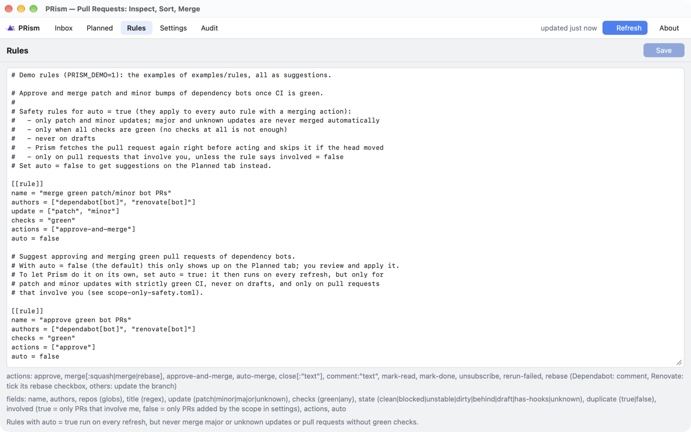
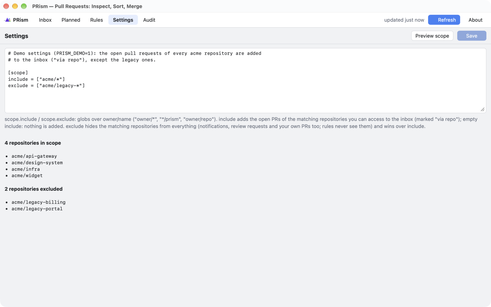

  

<h1 align="center">PRism</h1>

<em>Pull Requests — Inspect, Sort, Merge.</em>

  

PRism is a desktop inbox for GitHub pull requests for macOS, Linux and Windows. It collects the open pull requests you are involved in, sorts them into buckets, shows their CI and review state, and lets you review, approve and merge dependency bumps and other pull requests in bulk. Simple rules can do the routine work.

It is written in Rust on top of [Tauri v2](https://v2.tauri.app/) with a [Leptos](https://leptos.dev/) UI. It uses your own GitHub sign-in (the [GitHub CLI](https://cli.github.com/), `gh auth login`); there is no server and no telemetry, and nothing leaves your computer except the calls to the GitHub API.

## Features

- One inbox of the open pull requests that notify you, wait for your review or are yours; optionally all open pull requests of repositories you choose.
- Buckets Mine, Ready, Needs approval, Failing, Pending and Draft; filters by repository, text, unread, bots and humans.
- The same actions on the selected rows or the open one: approve, merge, auto-merge, rebase, re-run failed jobs, comment, close, mark read or done, unsubscribe.
- Dependency bumps are recognised (patch, minor, major) and superseded duplicates are flagged.
- Automation rules in a TOML file, edited in the app. By default rules only suggest; you apply them on the Planned tab.
- Every action is bound to the head commit you saw, and an audit log records what PRism did.

All features: [Features](https://github.com/dfuchss/prism/wiki/Features).

| Bulk approve and merge | Planned actions |
|---|---|
|  |  |

| Rules | Settings |
|---|---|
|  |  |

## Installation

Download the file for your machine from the [latest release](https://github.com/dfuchss/prism/releases/latest); `SHA256SUMS` lists the checksums. The builds are not signed, so the first start needs one confirmation.

| Platform | File | Install and first start |
|---|---|---|
| macOS 14+, Apple silicon | `prism-macos-arm64.zip` | [macOS](https://github.com/dfuchss/prism/wiki/macOS) |
| macOS 14+, Intel | `prism-macos-x86_64.zip` | [macOS](https://github.com/dfuchss/prism/wiki/macOS) |
| Linux, x86_64 | `prism-linux-x86_64.AppImage` (bundles its libraries) or `prism-linux-x86_64` (uses the system's) | [Linux](https://github.com/dfuchss/prism/wiki/Linux) |
| Linux, aarch64 | `prism-linux-aarch64.AppImage` or `prism-linux-aarch64` | [Linux](https://github.com/dfuchss/prism/wiki/Linux) |
| Windows 10 and 11, x86_64 | `prism-windows-x86_64.exe` | [Windows](https://github.com/dfuchss/prism/wiki/Windows) |

PRism does not update itself; download a newer release to update. The changes of every version are in the [changelog](CHANGELOG.md).

## Documentation

The [wiki](https://github.com/dfuchss/prism/wiki) has the [usage](https://github.com/dfuchss/prism/wiki/Usage), the [rules reference](https://github.com/dfuchss/prism/wiki/Rules), the [settings and sign-in](https://github.com/dfuchss/prism/wiki/Settings), [privacy and security](https://github.com/dfuchss/prism/wiki/Privacy-and-Security), the [known limitations](https://github.com/dfuchss/prism/wiki/Known-Limitations), [troubleshooting](https://github.com/dfuchss/prism/wiki/Troubleshooting) and, per platform, the data locations. Ready-to-copy rules are in [`examples/`](examples/). To build PRism yourself or to contribute, see [DEVELOPMENT.md](DEVELOPMENT.md).

## License

PRism is free software: you can redistribute it and/or modify it under the terms of the GNU General Public License as published by the Free Software Foundation, either version 3 of the License, or (at your option) any later version. See [`LICENSE`](LICENSE).

Copyright © 2026 Dominik Fuchß
