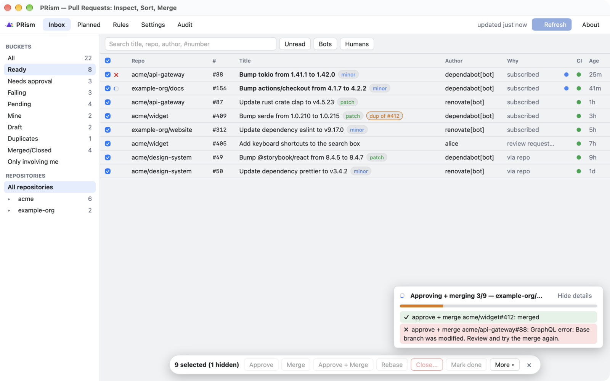
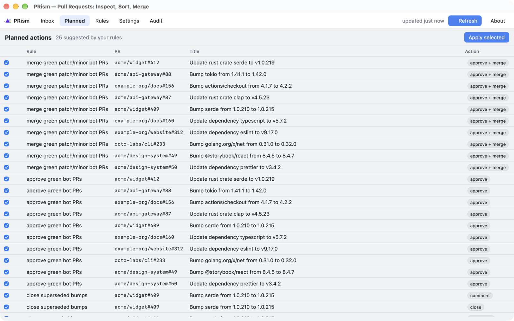
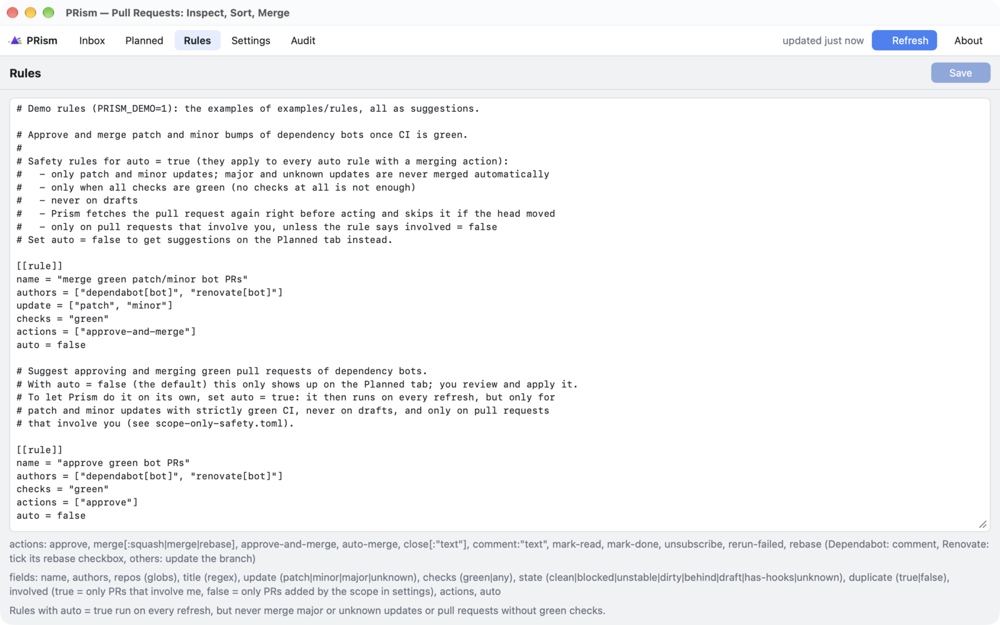
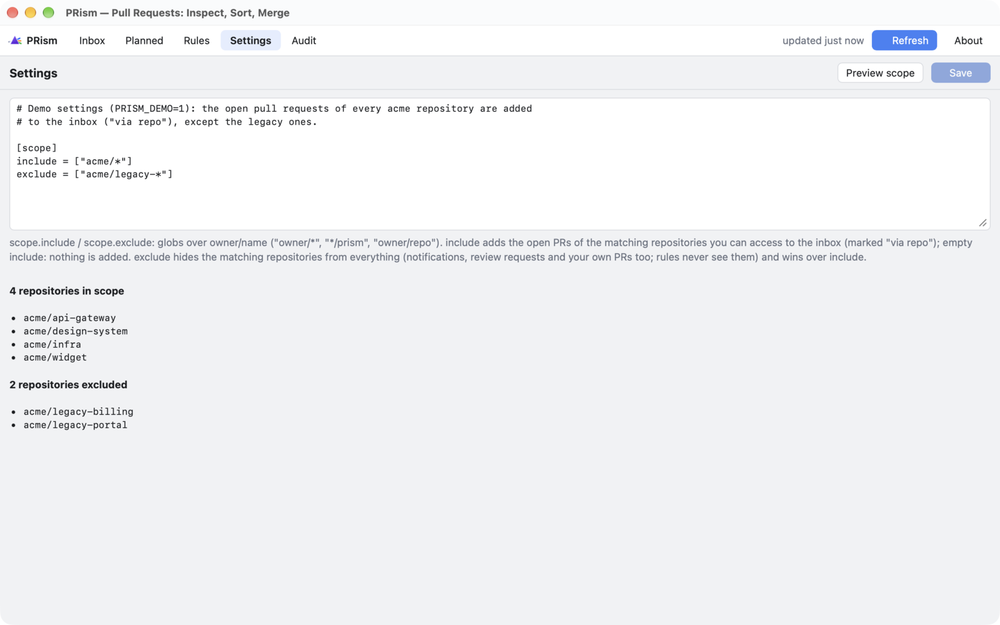
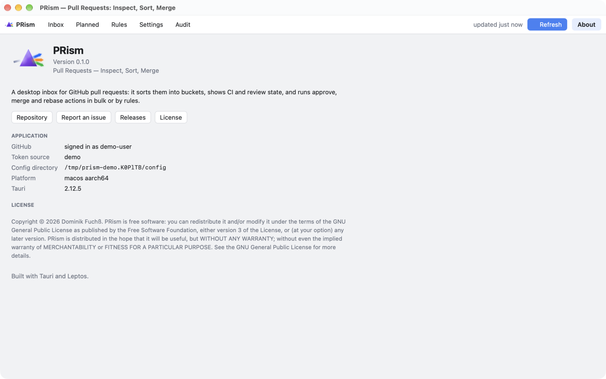
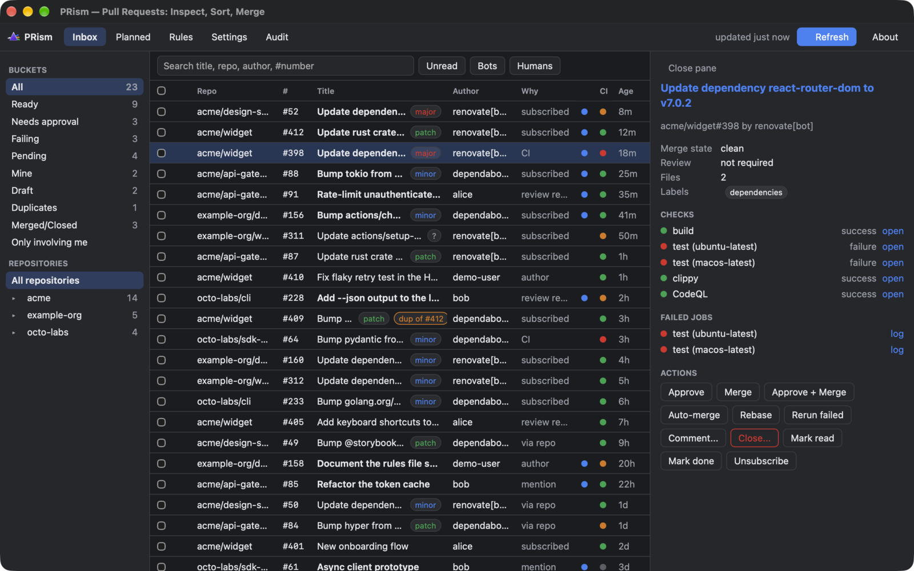

# Features

- **One inbox.** The open pull requests you are involved in: those that notify you, those that wait for your review and those you wrote.
  - Optionally, all open pull requests of repositories you choose are added too (see [Repository scope](Settings#repository-scope)).
  - Merged and closed pull requests that still have a notification are not bucketed; they are listed under "Merged/Closed" (with a state badge), where you can only mark them read or done or unsubscribe.
- **Buckets.** Mine, Ready, Needs approval, Failing, Pending and Draft, with counts (see [Usage](Usage#buckets)).
- **Filters.** By repository (grouped by owner), text, unread, bots or humans.
- **Actions in bulk or one by one.** The same actions on the selected rows (bulk bar) or the open one (detail pane): approve, merge, approve and merge, enable auto-merge, rebase, re-run failed jobs, comment, close with an optional comment, mark read or done, unsubscribe. Selected rows a filter hides stay selected but are not acted on. The detail pane also shows checks and failed jobs.
- **Dependency bumps.** Recognised from the title ("from X to Y", "to vY"); PRism knows patch, minor, major and unknown updates.
- **Duplicates.** Superseded duplicates (several pull requests bumping the same dependency in the same repository) are flagged; the one with the highest target version is kept.
- **Rules.** Automation rules in a TOML file, edited in the app. By default rules only suggest actions; you review and apply them on the Planned tab. [Automatic rules](Rules#safety-model) run on every refresh, under strict safety checks.
- **Safe by design.** Approve and merge are bound to the head commit you saw and re-check the pull request first.
- **Audit log.** Every action PRism ran, in the app and on disk.
- **No telemetry and no server.** Your GitHub sign-in is used only for calls to the GitHub API; see [Privacy and security](Privacy-and-Security).

## Screenshots

| Approve and merge in bulk | Planned actions |
|---|---|
|  |  |
| **Rules** | **Settings** |
|  |  |
| **About** | **Dark mode** |
|  |  |

The screenshots show demo data; see [Screenshots](Screenshots).
