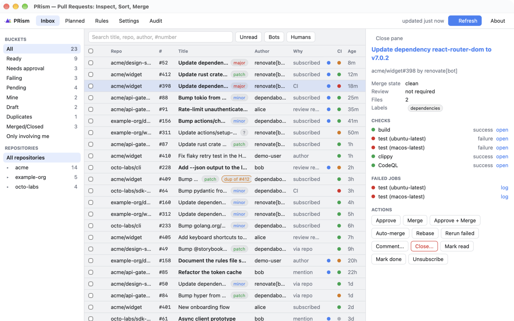

# PRism

*Pull Requests — Inspect, Sort, Merge.*

PRism is a desktop inbox for GitHub pull requests for macOS, Linux and Windows. It collects the open pull requests you are involved in, sorts them into buckets, shows their CI and review state, and lets you review, approve and merge dependency bumps and other pull requests in bulk. Simple rules can do the routine work.

It is written in Rust on top of [Tauri v2](https://v2.tauri.app/) with a [Leptos](https://leptos.dev/) UI. It uses your own GitHub sign-in; there is no server and no telemetry, and nothing leaves your computer except the calls to the GitHub API.

## Using PRism

- [Features](Features): what PRism does, with screenshots.
- [Usage](Usage): the inbox, buckets, filters, actions, keyboard shortcuts and the other tabs.
- [Rules](Rules): the rules reference, the actions and the safety model of automatic rules.
- [Settings](Settings): `settings.toml`, the repository scope and how PRism signs in to GitHub.
- [Privacy and security](Privacy-and-Security): what PRism protects and what it stores.
- [Known limitations](Known-Limitations): what does not work.
- [Troubleshooting](Troubleshooting): common problems and where to look.

## Platforms

Install, first start and data locations per platform:

- [macOS](macOS): macOS 14 or later, Apple silicon and Intel.
- [Linux](Linux): AppImage and plain binary for x86_64 and aarch64.
- [Windows](Windows): Windows 10 and 11, x86_64.

## Development

- [Building](Building): building from source.
- [Architecture](Architecture): the crates, the backend modules, the events and what PRism remembers.
- [Checks](Checks): the checks every commit must pass, and the CI.
- [Debug options](Debug-Options): demo mode and its environment variables.
- [Screenshots](Screenshots): how the screenshots are taken.
- [Releasing](Releasing): versions, the changelog and the release workflow.

The changes of every version are in the [changelog](https://github.com/<<REPO>>/blob/main/CHANGELOG.md).
